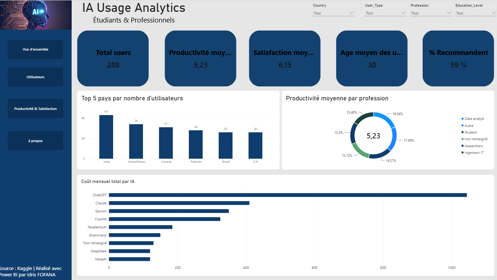
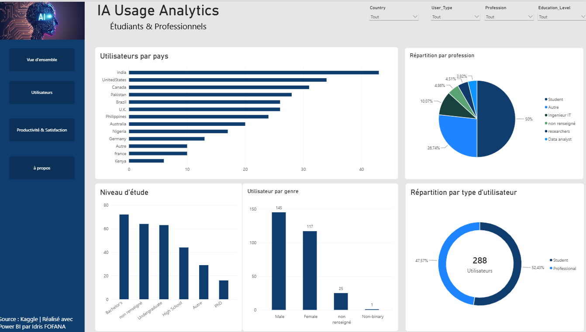

# 🤖 Usage et impact de l'IA chez les étudiants et les professionnels — Dashboard Power BI

Analyse de l'adoption des outils d'intelligence artificielle et de leur effet sur la productivité et la satisfaction des utilisateurs, à partir d'un dataset public Kaggle.

## 🎯 Objectif

Comprendre **qui utilise l'IA**, **comment**, et **avec quel impact** sur la productivité et la satisfaction, afin d'identifier les profils qui en tirent le plus de valeur.

## 📊 Chiffres clés

| Indicateur | Valeur |
|---|---|
| Utilisateurs analysés | **288** |
| Productivité moyenne | **5,23** |
| Satisfaction moyenne | **6,15** |
| Taux de recommandation | **59 %** |

## 🗂️ Le dashboard (4 pages)

### 1. Vue d'ensemble
KPIs principaux et tendances générales.

### 2. Utilisateurs
Profil des répondants : statut, usage, fréquence.

### 3. Productivité & Satisfaction
Impact perçu de l'IA selon les profils.

### 4. À propos
Contexte, source des données et méthodologie.

## 🛠️ Démarche

- **Import et nettoyage** des données dans **Power Query** (types, valeurs manquantes, normalisation des catégories)
- **Modélisation** et création de **mesures DAX** pour les KPIs
- **Visualisation** et mise en page orientée lecture rapide

## 📁 Contenu du dépôt

| Fichier | Description |
|---|---|
| `Projet_IA_usage.pbix` | Fichier Power BI du dashboard |
| `AI_Usage_and_Impact_on_Students_and_Professionals.csv` | Données sources |
| `*.png` | Captures des 4 pages |

## ▶️ Ouvrir le projet

1. Télécharger `Projet_IA_usage.pbix`
2. L'ouvrir avec [Power BI Desktop](https://powerbi.microsoft.com/desktop/) (gratuit)

## 📚 Source des données

Dataset public Kaggle : *AI Usage and Impact on Students and Professionals*.

## 🧰 Compétences mobilisées

`Power BI` · `Power Query` · `DAX` · `Data cleaning` · `Data visualization` · `Storytelling`

## 👤 Auteur

**Idris** — Master 2 MBA Finance Digitale, ISM Dakar
🔗 [GitHub](https://github.com/fofanaidris12) · [LinkedIn](https://www.linkedin.com/in/idris-fofana) · Actuellement à la recherche d'un stage en data / finance digitale
